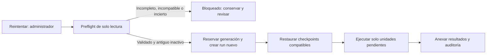

# Continuar casos fallidos sin perder avances

**Reintentar** conservará el expediente, su URL, eventos, artefactos y auditoría; una nueva ejecución usará el código del deployment vigente y retomará únicamente desde resultados completos y compatibles. Si no puede demostrar qué se completó o si una operación paga puede seguir en curso, no continuará ni hará llamadas por su cuenta.

Para `AT-185-GA` la recuperación es una posibilidad, no una garantía: hace falta un preflight autorizado de solo lectura y validar el journal y los artefactos reales. Este plan no implementa, despliega ni reinicia el caso.

## Qué cambia

### Continuación, no reset

`src/app/actions.ts` seguirá requiriendo administrador, pero **Reintentar** dejará de llamar a `requeueCase`/`restartCase`, que hoy eliminan los avances. Mostrará si el caso puede continuar, qué etapas se reutilizarán y por qué está bloqueado. Un caso activo o resuelto no será elegible. El rerun administrativo destructivo seguirá siendo una operación distinta y no se usará como alternativa automática; habrá que impedir que interfiera con una continuación reservada o activa.

El workflow fallido es terminal: no se reabre. La continuación crea un run y un journal nuevos con el deployment vigente, conserva la versión de pipeline y los modelos del caso, y recupera solo los resultados compatibles. Se mantendrán las firmas y secuencias de los runs ya activos para no romper su replay.



### Checkpoints y fases

Agregar en `src/store.ts` un registro versionado de continuación por unidad lógica y generación, con tipo, clave estable, huella de entradas, versión de formato y pipeline, estado, resultado o referencia con hash, y procedencia del run/deployment. Mantener el estado de cada operación externa por separado: `pending`, `running`, `ready`, `failed` o `uncertain`. No considerar `ready` hasta validar el resultado completo y sus artefactos. En una transacción se publicarán los eventos, el avance de fase y sus referencias; una repetición idéntica será inocua y una colisión con contenido distinto fallará, en vez de ignorarse por `(case_id, seq)`.

```ts
type ContinuationCheckpoint = {
  unit: string; inputHash: string; pipeline: number; format: number;
  state: "ready" | "uncertain"; resultRef?: string; resultHash?: string;
  sourceRunId: string; sourceDeploymentId?: string;
};
```

En `src/court/procedure.ts` y `src/court/quick.ts`, sustituir el supuesto de un `log` vacío por un cursor explícito de unidades y decisiones: cargar el prefijo validado, respetar el siguiente `seq`, restaurar resultados de asientos individuales y continuar por dependencias. La publicación ordenada de rondas paralelas debe ser atómica, incluso si un asiento terminó y otro falló. Cubrir identificación y respuestas/votos de Quick, instrucción, lotes y cotejo de fuentes, revisión, traducción y cierre de evidencia, debate y objeciones, votos, desempates, resumen, portada y archivo. Una respuesta terminada no se vuelve a generar aunque su ronda aún no haya sido publicada.

`src/court/phase-session.ts` ya conserva mensajes, turnos y revisiones CAS, y exige igualdad de modelo, herramientas y prompt; conservar esa verificación y agregar generación y compatibilidad explícita. Un turno agotado, incompleto o sin resultado demostrable no se considera terminado. No reiniciar su presupuesto ni reconstruir una conversación por aproximación. Si cambia un prompt o contrato incompatible, bloquear salvo que exista un adaptador probado que preserve el significado de todos los datos.

### Aislamiento y operaciones externas

Reservar una sola generación por caso bajo bloqueo transaccional. Todo escritor nuevo —estado, eventos, checkpoints, operaciones y alias de fuente, auditoría, modelos, idioma, portada, referencias Blob y bindings del sandbox— debe comprobar la generación y el run en la misma transacción que publica; rechazar escritores viejos. Usar objetos inmutables con nombres aislados por generación y publicar sus referencias solo bajo ese mismo control, sin sobrescribir las claves actuales. Las autorizaciones del broker y la limpieza también deben comprobar generación, para que un run viejo no revoque ni borre recursos del nuevo.

El fencing nuevo **no protege contra código ya desplegado que no lo conoce**. Antes de continuar un caso anterior, verificar con acceso autorizado que no hay pasos iniciados ejecutándose, ni comandos separados, grants o efectos externos que aún puedan escribir o cobrar; la cancelación o un lease vencido por sí solos no lo prueban. Si no se puede demostrar, bloquear. Mantener el mismo criterio al pasar entre generaciones nuevas; no tomar posesión de una operación `running` solo porque expiró su lease.

Registrar durablemente la intención y una clave estable antes de cada llamada paga o efecto externo; comprobar ownership al iniciar y al publicar. Reutilizar un resultado completo con entrada idéntica; controlar también los reintentos automáticos de SDK y workflow para que no repitan una llamada de resultado incierto. Conciliar una llamada interrumpida solo con evidencia del proveedor o un resultado durable verificable. Si se perdió la respuesta entre el efecto y su publicación, marcar `uncertain` y bloquear: no se garantiza facturación exactamente una vez. Una nueva llamada para esa unidad requiere revisión y autorización explícita de un administrador, motivo auditado y certeza de que la llamada anterior ya no puede seguir activa; no basta con apretar Reintentar.

La reserva y el arranque también tienen una ventana incierta: pasar la generación y un token estable al nuevo run; su primer paso debe registrar el `runId` mediante CAS antes de cualquier efecto. Si `start()` pierde la respuesta, reconciliar únicamente con evidencia inequívoca del run registrado; si no existe, dejar la reserva bloqueada, sin lanzar otro run ni cambiar el caso a fallido prematuramente.

### Recuperación de `AT-185-GA`

Los logs disponibles muestran 33 enlaces consultados, cuatro ilegibles y agotamiento repetido en `file_proposals`. No prueban por sí solos que todos los resultados estén disponibles: `source_batch_completed` registra conteos y, según el pipeline, URLs/estado, pero no necesariamente los `sourceId` ni errores completos. La CLI local no tiene credenciales del journal; no se verificó el estado recuperable de producción.

1. Con acceso autorizado, inspeccionar **solo en lectura** el run, sus pasos y resultados disponibles, secuencia de eventos, operaciones y alias, checkpoints, auditoría y existencia e integridad de Blob. No imprimir contenido sensible ni credenciales.
2. Verificar pipeline y modelos, ausencia de escritores/comandos antiguos y completitud del prefijo de eventos. Para cada URL propuesta, exigir el resultado exacto del paso en el journal **o** una reconstrucción determinista y completa de `FetchedUrl` desde operaciones/alias y artefactos existentes, con correspondencia, hashes y estado de error comprobados. No inferir el resultado de una URL a partir de un conteo. Validar que las fuentes utilizables incluyen sus documentos y bloques originales intactos; preservar las cuatro fallas tal como consten, sin descargarlas de nuevo.
3. Solo si se prueban todos los prerrequisitos, importar los resultados verificados a checkpoints nuevos con su procedencia y continuar desde el cotejo pendiente, usando el fix local de una lectura del expediente por intento una vez que esté en el deployment elegido. Verificar primero si el cotejo o algún efecto posterior ya se completó. Si el journal no está disponible, los errores no se reconstruyen, hay artefactos ausentes, incompatibilidad, llamadas inciertas o actividad vieja sin resolver, dejar el caso bloqueado con diagnóstico; no recurrir al reset ni a descargas o llamadas pagas silenciosas.

### Compatibilidad, auditoría y retención

Definir una matriz explícita de compatibilidad para Quick y pipelines `1`–`5`: solo habilitar una ruta cuando sus checkpoints, contratos de fase y pruebas estén soportados; los casos antiguos sin evidencia suficiente quedan bloqueados, no se migran por suposición. Importadores históricos aceptan únicamente formatos y pasos concretos probados, preservando IDs, secuencias, fechas, errores, modelos y procedencia. No convertir automáticamente un caso al pipeline más reciente. Los checkpoints nuevos agregan capacidad futura; los eventos existentes, la auditoría y el journal no equivalen automáticamente a un checkpoint completo.

Anexar auditoría de preflight, generación, administrador, run/deployment, decisiones de reutilización, bloqueos y autorizaciones, sin exponer texto privado en logs. Conservar eventos y artefactos originales; la continuación no borra sandboxes ni snapshots necesarios. `disposeSandboxes`, `deleteCaseSandboxes` y `sweepCaseSandboxes` hoy pueden borrar sandboxes de casos fallidos y sus snapshots, con expiración configurada de 24 horas: ajustar esas rutas para proteger referencias requeridas y aislar generaciones; no prometer recuperar snapshots ya eliminados. Mantener permisos y políticas de privacidad existentes; conservar la evidencia necesaria sin borrado automático durante la recuperación. Ante cuotas o límites de retención configurados, avisar y bloquear en lugar de eliminarla. Estimar y monitorear costo de almacenamiento y operaciones pendientes; informar un rango solo si se puede estimar y no imponer llamadas pagas adicionales ocultas.

## Pasos

- [x] 1. Diseñar y probar la matriz de unidades, efectos y compatibilidad por pipeline; inventariar todas las escrituras y llamadas externas, incluidos portada, archivo, broker y limpieza. Conservar los cambios locales existentes y el fix previo. Matriz e inventario en `docs/continuation-inventory.md`; 9 pruebas locales reproducen los límites. Ninguna ruta está habilitada.
- [ ] 2. Añadir almacenamiento aditivo, reserva de generación, fencing transaccional, auditoría y reconciliación de arranque; cubrir writers y operaciones en `src/store.ts`, `src/workflows/steps.ts`, `src/lib/case-workflow.ts` y el broker. Base local desactivada; las operaciones generacionales registran intención canónica y bloquean predecesores ambiguos mediante inventario completo bajo lock. Revisión independiente, 58 pruebas dirigidas y typecheck pasaron; el fixture aislado verificó siete carreras y fallos SQL con PostgreSQL 17.11/read committed, no efectos externos ni el protocolo completo de arranque. PhaseSession cuenta además con retención SQL de snapshots siempre bloqueados, CAS, auditoría y fencing; revisión local, 45 pruebas dirigidas y typecheck pasaron, pero las nuevas operaciones solo se probaron con doble SQL, no con PostgreSQL real. Faltan SDK/control plane, inactividad histórica y efectos/retención protegidos. El canonicalizador rechaza arrays dispersos, datos ocultos, accesores y proxies sin cambiar los hashes de JSON ordinario; revisión independiente, typecheck y 40 pruebas dirigidas pasaron. Publicación de checkpoints sin validadores y rutas siguen bloqueadas.
- [ ] 3. Implementar checkpoints de resultados y cursores de fase en `src/workflows/court-session.ts`, `src/court/procedure.ts`, `src/court/quick.ts` y `src/court/phase-session.ts`; preservar la secuencia de runs existentes. Hay una unidad pura acotada de consenso Quick 5 y un cotejo offline separado de ocho resultados completos de analistas Quick 5 textual sin claims/intento 0. Además hay un cotejo offline de exportaciones PhaseSession Expert 2–5, con generación y configuración explícitas, límites de presupuesto y diagnóstico de interrupciones; revisión independiente, 43 pruebas dirigidas y typecheck pasaron. Un cotejo offline adicional contrasta cursor Expert 2–5 con prefijos, IDs legacy y mensajes reales; 39 pruebas dirigidas y typecheck pasaron independientemente. Ningún adaptador habilita rutas, autentica procedencia histórica, restaura turnos o recupera rondas parciales.

**Orden ajustado por seguridad:** adelantar el bloqueo de Reintentar de los pasos 6–7 antes de seguir con los cursores, porque actualmente todavía invoca el reset destructivo. No declarar completos esos pasos hasta implementar el preflight y verificar el plan íntegro.
- [ ] 4. Proteger autorización, Blob, sandboxes, snapshots y barrido por generación; registrar operaciones externas inciertas y exponer su revisión explícita. Retención conservadora parcial; delete/rerun se bloquean antes de borrar DB/Blob para no dejar sandboxes privados huérfanos. Staging generacional experimental coteja bytes, pero la publicación productiva bloquea incondicionalmente antes de DB incluso con un recibo auténtico; protocolo transaccional solo en un modelo de test. Revisión independiente, 13 pruebas dirigidas, smoke offline sin DB/fetch y typecheck pasaron; no prueban procedencia ni retención reales. Pendientes aislamiento integrado, conciliación, cuotas y liberación segura; la retención indefinida puede aumentar costos.
- [ ] 5. Agregar preflight y adaptadores históricos acotados, incluyendo la reconstrucción verificable de los lotes de fuentes de `AT-185-GA`; bloquear formatos no demostrados. Adaptador de fuentes offline sintético Expert 3/4/5 cotejado contra contratos locales, sin integración ni evidencia histórica real; preflight permanece bloqueado. La prueba independiente dirigida pasó 27/27 y, tras corregir el hash canónico, la selección cruzada pasó 40/40; falta demostrar procedencia, publicación e inactividad históricas.
- [ ] 6. Cambiar la acción y la vista de **Reintentar** para presentar reutilización, costos pendientes y bloqueos sin reset; separar el rerun destructivo existente. Bloqueo local de acción y vista implementado y probado; preflight y presentación de resultados recuperables aún pendientes. Leer antes las guías aplicables en `node_modules/next/dist/docs/`.
- [ ] 7. Actualizar pruebas y documentación operativa y de retención, con despliegue gradual desactivado por defecto: mientras esté desactivado, **Reintentar** queda bloqueado, nunca vuelve al reset. El rollback también deshabilita nuevas continuaciones sin borrar datos ni restaurar el reset destructivo. Bloqueo local probado; aún faltan la documentación y pruebas integrales.

## Cómo se verifica

- [ ] Tests de cada unidad y fase: interrumpir antes y después de publicar, recuperar desde el prefijo, verificar `seq` e IDs estables y que cada resultado terminado se reutilice sin repetir llamadas, incluidas rondas parciales, Quick y efectos posteriores al cierre.
- [ ] Tests de carreras con PostgreSQL local aislado: dos reintentos, cancelación, respuesta perdida de `start()`, escritores y cleanup tardíos, CAS, colisiones de eventos y objetos; un único run gana y ninguno antiguo modifica la generación nueva.
- [ ] Inyectar fallos antes/durante/después de operaciones pagas, escritura de Blob y publicación; comprobar que `running` vencido o `uncertain` bloquea, y que solo la conciliación o autorización auditada permite avanzar.
- [ ] Probar pipelines `1`–`5`, Quick, prompts/modelos incompatibles, checkpoints corruptos, journal no disponible, snapshots vencidos y resultados ausentes: continuar solo las rutas validadas; en otro caso conservar todo y bloquear.
- [ ] Con fixture local representativa de `AT-185-GA`, cotejar resultados por URL y errores, simular journal ausente y cuatro lecturas fallidas; demostrar cero nuevas descargas/generaciones para resultados reutilizados y una sola lectura del expediente por intento de cotejo.
- [ ] Ejecutar `npm test`, `npm run typecheck`, `npm run build` y las pruebas PostgreSQL documentadas en `docs/shared-instruction.md`, con base local protegida y proveedores simulados; comprobar que no se invoca Blob ni IA paga.
- [ ] Antes de una eventual operación real, ejecutar el preflight autorizado de solo lectura sobre `AT-185-GA` y revisar el informe. La ejecución y el despliegue requieren autorización separada.

## Decisiones

| Decisión | Elección | Por qué |
| --- | --- | --- |
| Sin evidencia completa | Bloquear, incluso para casos antiguos | Evita pérdida de datos y repetición no consentida. |
| Pipeline y modelos | Mantener los originales y exigir compatibilidad | El deployment nuevo no implica cambiar la semántica del expediente. |
| Operación incierta | Conciliar o pedir autorización específica y auditada | No hay garantía de cobro exactamente una vez. |
| Rerun destructivo | No usarlo como fallback de Reintentar | Conserva los avances y hace explícita la diferencia. |

## Riesgos y límites

- Un run viejo puede seguir escribiendo después de cancelar; no habilitar la continuación si no se demuestra su inactividad, aunque el fencing nuevo ya exista.
- Los checkpoints existentes no registran todos los resultados; un journal inaccesible o snapshots ya eliminados pueden impedir recuperar `AT-185-GA`.
- Más checkpoints y retención aumentan almacenamiento y complejidad; controlar cuotas, acceso y caducidad sin eliminar datos necesarios.
- El árbol contiene cambios sin confirmar de otras tareas y el fix previo. Integrarlos sin sobrescribirlos; las pruebas existentes de reset deben distinguir esa operación de la continuación.

## Fuera de alcance

- Desplegar, modificar producción, reiniciar `AT-185-GA` o autorizar llamadas pagas durante esta planificación.
- Reconstruir resultados por conjetura, restaurar artefactos ya perdidos o garantizar recuperación y cobro exactamente una vez en todos los casos.
