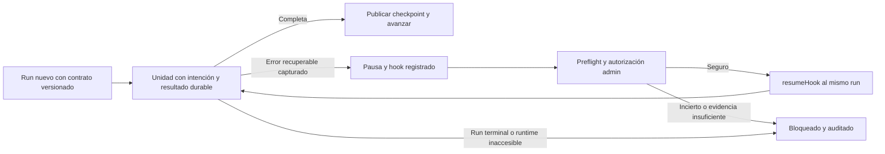

# Reintento seguro para workflows nuevos sin re-run

## Objetivo y alcance

Solo los casos **creados desde el inicio bajo el nuevo contrato versionado de retry** podrán ofrecer esta opción. Los workflows existentes no son reintentables con este concepto: no se migran, reconstruyen ni importan sus avances, y no se supone que `AT-185-GA` pueda recuperarse. El plan anterior [continuación segura](2026-11-07-continuacion-segura.md) permanece bloqueado; este plan sustituye su dirección de recuperación histórica, no afirma que el trabajo parcial esté terminado.

Para un workflow nuevo, **Reintentar** reanuda el mismo run, sin borrar el expediente ni volver a ejecutar unidades completas. Los resultados, artefactos, cursores y operaciones se registran desde el principio. Ante evidencia ausente, corrupción o un efecto externo incierto, se conserva todo y se bloquea, sin repetir llamadas pagas silenciosamente. La opción no promete recuperar todo error ni facturación exactamente una vez.

## Mecanismo y límite del SDK

Con `workflow` 5.2.3 instalado, el mecanismo propuesto es mantener vivo el run: capturar los fallos recuperables de sus pasos, registrar la pausa y esperar un `createHook`; una acción administrativa autorizada verifica el estado y llama a `resumeHook` para despertar **ese mismo run**. El workflow valida la orden y reintenta solo la unidad pendiente permitida. El registro del hook debe estar confirmado antes de anunciar que puede reanudarse; `createHook()` por sí solo no confirma el registro. No usar `experimental_force` para apropiarse de un hook ajeno.

**Un run `failed`, `cancelled` o finalizado es terminal:** `resumeHook` no lo reabre. También pueden existir fallos del runtime/control plane, errores no capturables o pérdida del deployment que impidan alcanzar la pausa. En esos casos mostrar bloqueo y diagnóstico, sin invocar `start()`, SDK Re-run, otro run ni reset como alternativa. Una nueva ejecución desde cero sigue siendo una operación administrativa separada, no el retry de este plan.

El run está fijado al deployment que lo inició: al reanudarlo usa ese código, no un fix desplegado después. La conservación y disponibilidad de ese deployment y del journal/hook son requisitos operativos a comprobar; si no se satisfacen, bloquear. El contrato no promete aplicar fixes de código a un run en espera. Referencias locales: `node_modules/workflow/docs/foundations/versioning.mdx`, `foundations/errors-and-retries.mdx`, `api-reference/workflow/create-hook.mdx` y `api-reference/workflow-api/resume-hook.mdx`.

## Contrato de evidencia y seguridad

- Al crear el caso, persistir versión explícita del contrato, identidad de caso/run/deployment, pipeline, modelos, prompts/herramientas y demás configuración semántica. La ausencia o una versión desconocida significa **no elegible**. No inferir elegibilidad de fechas, logs o versión de pipeline. Mantener intactas las firmas y secuencias de los runs existentes.
- Para cada unidad lógica, persistir clave estable, dependencias, huella canónica de entradas, versión de formato, resultado completo o referencia inmutable con hash, estado y procedencia. Registrar explícitamente unidades omitidas con motivo, errores y resultados parciales por asiento; conservar IDs, secuencia de eventos, timestamps, idioma, presupuestos y mensajes necesarios. Los logs de observabilidad son apoyo, no sustituyen resultados completos ni constituyen por sí solos evidencia de recuperación.
- Cubrir las rutas nuevas Quick y Expert que se habiliten: identificación, respuestas y votos; instrucción y fuentes por URL/lote con resultados y errores exactos; sesiones, turnos y herramientas; rondas y objeciones; traducción, cierre, portada, archivo y limpieza. Publicar atómicamente el avance, referencias y eventos de cada frontera; una colisión distinta o referencia no verificable bloquea. Una ronda parcial conserva resultados terminados sin publicarlos fuera de orden ni repetirlos.
- Antes de cada efecto externo registrar intención durable, clave e identidad de entrada; después conservar resultado completo verificable y publicar bajo fencing. Distinguir `pending`, `running`, `ready`, fallo demostrado y `uncertain`. Un timeout, lease vencido, cancelación o respuesta perdida no demuestra que la llamada anterior terminó. Conciliar con evidencia inequívoca del proveedor o resultado durable; de lo contrario bloquear. Una eventual nueva llamada requiere autorización administrativa específica y auditada **y** prueba de inactividad anterior. Controlar también retries del SDK Workflow, SDK de IA, proveedores, broker y procesos/sandboxes: no asumir que están desactivados ni garantizar cobro exactamente una vez.
- Serializar reintentos y escrituras con control transaccional de propietario, run e intento/época; proteger eventos, estado, operaciones, checkpoints, aliases, Blob, grants, sandboxes y cleanup. Un intento o comando tardío no puede publicar sobre uno nuevo. La reserva de intento nunca toma posesión de un efecto `running` solo porque expiró un lease. Adaptar el fencing generacional parcial a intentos del **mismo run**, sin crear una generación que implique otro run.
- Usar artefactos con identidad y contenido verificables, almacenamiento inmutable o protección equivalente demostrada, y publicación de referencias bajo fence. Definir retención, permisos, privacidad, cuotas, reconciliación y limpieza segura para DB, objetos, journal y sandboxes. Si falta retención o espacio, avisar y bloquear; no borrar evidencia necesaria. Evitar prompts, datos sensibles o tokens en logs de observabilidad.

## Pausa y reanudación

1. El workflow traduce errores esperables a una decisión durable (`pausado`, `bloqueado` o terminal), con motivo, unidad y evidencia, sin convertir un resultado incierto en fallo seguro. Distinguir estado del caso del estado real del SDK; un caso pausado no es un run fallido.
2. Confirmar el registro del hook del run y reconciliar la ventana entre hook y estado durable antes de exponer Reintentar. Conflicto, fallo de registro, run no identificable, inactividad no probada o estado incoherente mantienen la acción bloqueada.
3. Preflight de solo lectura para admin: contrato, run/deployment y hook correctos y activos, integridad de checkpoints y artefactos, unidad siguiente, estado de efectos y costos pendientes conocidos o no estimables. No realizar efectos ni asumir que conectar al store es solo lectura si su bootstrap ejecuta DDL.
4. Registrar la solicitud con clave idempotente y auditoría; autorizar por caso y admin antes de `resumeHook` (el token no autoriza). El payload identifica solicitud, versión de contrato y estado esperado, sin secretos ni contenido privado. Validar de nuevo bajo lock/fence al procesarlo en el workflow.
5. Tratar respuesta perdida de `resumeHook` como ambigua: una nueva invocación puede agregar otro `hook_received`. Reconciliar evidencia y deduplicar durablemente por clave propia, tanto en el emisor como en el consumidor, para que dos señales nunca autoricen dos intentos o efectos. Si no puede demostrarse la entrega/estado, mantener bloqueo; no anunciar éxito prematuro ni crear otro run.
6. Si el mismo código no puede resolver el error, si el hook desaparece, el run es terminal o el journal/deployment no está disponible, informar el límite y conservar el expediente. Ninguna de estas condiciones habilita un reset automático.

## Trabajo parcial: reutilizar o descartar

| Pendiente anterior | Tratamiento en este plan |
| --- | --- |
| `docs/continuation-inventory.md`, matriz de unidades y efectos | Reutilizar como inventario inicial, revisar el call graph y diseñar solo las rutas nuevas. Los conteos sintácticos no prueban cobertura. |
| `src/domain/continuation.ts`, `src/store.ts`, reservas, operaciones, auditoría y fencing | Evaluar y adaptar tras pruebas al mismo run y a intentos; no asumir que reservas de un run nuevo o publicación bloqueada ya implementan este mecanismo. |
| `src/domain/continuation-phase.ts`, cursores y snapshots de PhaseSession | Aprovechar contratos, CAS y validaciones pertinentes para evidencia generada por el nuevo workflow. Snapshots actuales son siempre `blocked`, no restauran estado y no se verificaron en PostgreSQL real. |
| `src/evidence/generation-artifacts.ts` y retención parcial | Aprovechar el diseño solo tras demostrar aislamiento, procedencia, retención y publicación remota/DB; la publicación productiva sigue bloqueada. |
| Importadores y cotejos históricos de fuentes, Quick y Expert; preflight histórico de `AT-185-GA` | No son requisitos de este alcance. No conectarlos ni invertir trabajo en reconstruir datos históricos; evaluar separadamente si alguna validación pura sirve para el contrato nuevo. |
| `src/lib/continuation-start.ts` y reconciliación de arranque de un nuevo run | No usar como mecanismo de retry. El arranque **inicial** del caso nuevo aún debe resolver respuesta perdida sin duplicar runs ni efectos. |

Hoy `CONTINUATION_ENABLED = false`, las diez rutas del inventario y `retryCase` siguen bloqueados **localmente**; cambiar un flag no completa las garantías y no demuestra protección desplegada.

## Pasos de implementación futura

### Progreso de implementación — 2026-11-07

- [x] Base local del paso 1: esquema `same-run-retry/1`, snapshot/huellas de creación y configuración, payload de orden por intento/época y reductor de preflight sin DB/SDK. Matriz inicial Quick/Expert nuevos y límites en [`docs/retry-workflows.md`](../../docs/retry-workflows.md).
- [x] Probe aislado del SDK/World local: captura de fallo de step, hook confirmado antes de exposición, mismo run y reutilización del resultado completo, entrega duplicada con una unidad pendiente, conflicto y terminales bloqueados. Cero proveedores; no es implementación productiva ni prueba de control plane.
- [x] Verificación local de esta base: tests dirigidos, `npm run typecheck`, `npm run build` y segunda corrida `npm test` (682/682). Primera corrida falló en FileList de `dependency-overrides.test.ts:14`; test aislado pasó y se propuso investigación de intermitencia. PostgreSQL/control plane/objetos y rutas end-to-end no verificados.
- [ ] Completar paso 1: comprobar retención y disponibilidad del deployment/World objetivo en entorno autorizado; implementar creación atómica exclusiva junto con el paso 2. El World local identifica `dpl_local@5.1.2` por versión del paquete, no por código inmutable; `experimental_retention: default` no acredita un plazo mínimo. No se consultó producción ni se solicita habilitación.
- [ ] Pasos 2–7: permanecen pendientes; no hay productor de contrato, almacenamiento por intento, checkpoints de rutas, efectos instrumentados, workflow nuevo ni acción/UI conectados. No confundir el reductor y el probe con una ruta ejecutable de retry.

Los ítems originales y criterios de aceptación siguientes siguen abiertos. Se
conservó el trabajo previo sin cambios y no se tocó ningún caso ni proveedor.

- [ ] 1. Definir versión nueva de contrato, elegibilidad exclusiva desde creación y matriz de unidades/efectos para Quick y Expert; fijar semántica de pausa, terminalidad, deployment fijado, costos y compatibilidad. Comprobar capacidades reales de hook, journal, status y retención del World objetivo antes de prometer disponibilidad.
- [ ] 2. Adaptar almacenamiento aditivo, auditoría, CAS/fencing por run e intento y reconciliación del arranque inicial. Proteger todas las rutas de escritura, stop/reset, broker y cleanup; mantener deshabilitado el retry hasta completar los requisitos.
- [ ] 3. Producir desde el origen checkpoints/resultados y artefactos durables para cada unidad habilitada, con publicación coherente de eventos, cursores y rondas parciales; preservar configuración y presupuestos de fase. Validar integridad y retención reales antes de aceptar referencias.
- [ ] 4. Instrumentar intenciones y resultados por cada subefecto externo, controlar retries automáticos y conciliar operaciones inciertas. Impedir que escritores o procesos previos sigan publicando y conservar evidencia/sandboxes necesarios.
- [ ] 5. Implementar workflow nuevo con errores recuperables capturados y pausa durable, registro confirmado de hook y orden idempotente de reanudación; reconciliar fallas entre DB, hook y despacho. Estados terminales o no demostrables quedan bloqueados, sin `start()` ni Re-run.
- [ ] 6. Agregar preflight, acción y vista administrativas para casos elegibles con estados, motivo y costos conocidos/desconocidos. Mantener casos anteriores bloqueados y distinguir la operación destructiva separada. Leer primero las guías Next aplicables en `node_modules/next/dist/docs/`.
- [ ] 7. Documentar retención, monitoreo, conciliación y límites de deployment; activar gradualmente solo rutas nuevas completamente verificadas. Rollback deshabilita nuevas reanudaciones sin borrar evidencia ni volver al reset. El despliegue y cualquier prueba con proveedores reales requieren autorización separada.

## Verificación y criterios de aceptación

- [ ] Con proveedores simulados, interrumpir antes y después de cada frontera, incluso rondas paralelas y efectos posteriores al cierre: el mismo `runId` conserva eventos/artefactos y cada resultado completo se usa sin nuevas llamadas; ninguna unidad se omite por falta de datos.
- [ ] En PostgreSQL local aislado y doble de almacenamiento de objetos, probar reservas concurrentes, CAS, colisiones, writers tardíos, limpieza, rollback y respuesta perdida; comprobar además en PostgreSQL real local las operaciones nuevas de PhaseSession, no solo el doble SQL existente.
- [ ] Inyectar fallos de llamadas y respuestas perdidas, retries internos, operaciones en curso, expiración de lease y comandos tardíos; `uncertain` bloquea hasta conciliación o autorización específica con inactividad demostrada. Verificar cero llamadas pagas reales en las pruebas.
- [ ] Probar con el SDK/World local la captura de errores, registro antes de exposición, dos solicitudes simultáneas, entrega duplicada/ambigua, hook no encontrado y run terminal: mismo run y un solo intento autorizado, o bloqueo explícito. No interpretar un doble local como prueba del control plane de producción.
- [ ] Validar disponibilidad y límites efectivos del World y del deployment fijado en un entorno autorizado antes de habilitar una ruta; si no se demuestra, mantenerla bloqueada. Simular pérdida de journal, deployment y artefactos, límites de cuota y versiones incompatibles.
- [ ] Demostrar que casos sin contrato nuevo, casos antiguos y `AT-185-GA` no pueden usar este retry ni activar por fallback reset, SDK Re-run o `start()`. Verificar permisos de admin y ausencia de secretos en logs.
- [ ] Ejecutar pruebas dirigidas, `npm test`, `npm run typecheck`, `npm run build` y fixture PostgreSQL documentado con recursos locales aislados. Revisar resultados antes de cualquier habilitación.

## Fuera de alcance de esta entrega

Implementar, desplegar, modificar producción, consultar o cambiar `AT-185-GA`, ejecutar llamadas pagas, migrar workflows existentes o recuperar runs terminales. Este archivo es un plan para revisión e implementación posterior.
